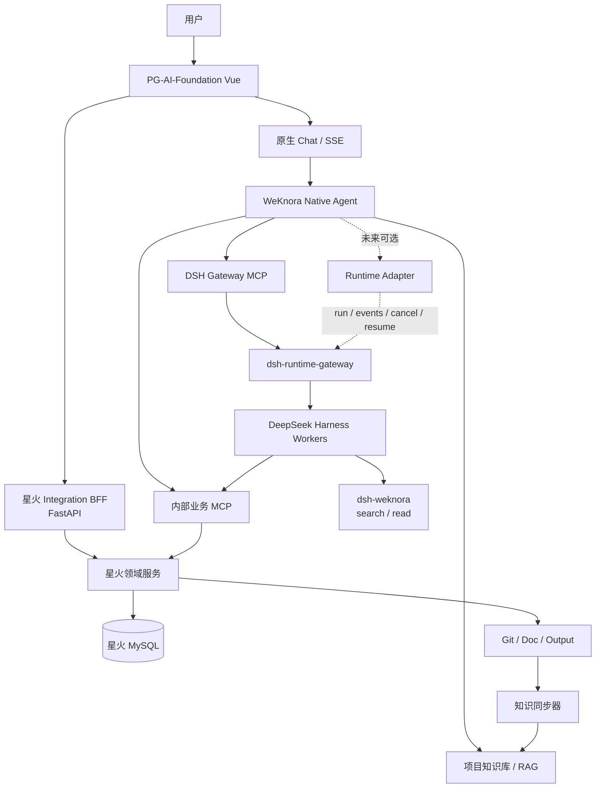
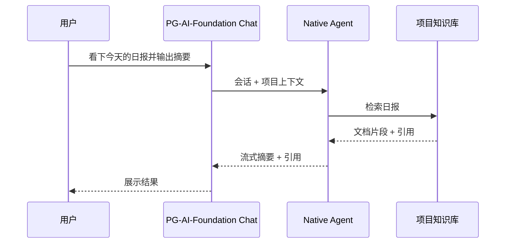
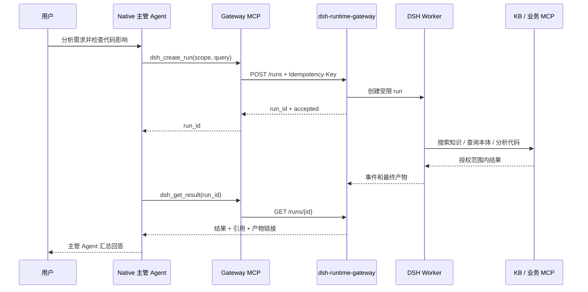

# PG-AI-Foundation × DeepSeek Harness × 星火能力迁移总实施方案

> 版本：V2.0  
> 日期：2026-09-29  
> 方案状态：推荐实施基线，尚未实施  
> 目标仓库：`https://github.com/yule1104/WeKnora-dsh.git`  
> 开发基线：`WeKnora-dsh/main@0c6b30cfa705c1d2f2ccd084cd76174738a7fb4b`  
> 现网基线：WeKnora v0.8.2，镜像 revision `3e8b0bfc80b845b2d4b2ed683994748741450a97`

## 1. 执行结论

本方案把原来的两套工作合并成一个总计划，并保留两个可独立评审、统一排期的子设计：

1. **子设计 A：DeepSeek Harness 运行时接入。**第一阶段部署独立 `dsh-runtime-gateway`，把 DSH 能力作为 MCP 工具接入 PG-AI-Foundation。此阶段不修改 WeKnora Go Agent 主链路。
2. **子设计 B：星火业务能力迁移。**迁移项目、Git、需求、本体、资料和部署页面；业务规则、事实数据、确认与发布仍由星火 FastAPI/MySQL 负责。

推荐顺序为 P0–P6。先完成双基线和项目绑定，再接入 DSH Gateway，随后建设内部草稿 MCP，最后按“需求 → 本体 → 编码/部署”逐步迁移 Agent。未来只有在确实需要完整流式步骤、统一停止、恢复和 run 级持久化时，才实施可选 `Runtime Adapter`。

### 1.1 一期明确决策

| 决策 | 一期选择 | 原因 |
|---|---|---|
| DSH 接入方式 | 独立 Gateway + MCP | 复用现有 MCP，降低 WeKnora Go 合并成本 |
| 用户对话入口 | PG-AI-Foundation 原生 Chat | 避免面向用户保留两套聊天与会话 |
| 项目页面 API | 星火 FastAPI Integration BFF | 不在 WeKnora Go 中承载星火领域接口 |
| 复杂任务模式 | Native 主管 Agent 委托 DSH 工作 Agent | DSH 只返回任务结果，不直接拥有用户会话 |
| Agent 写权限 | 只能创建候选 | 确认、发布、部署执行保留人工门禁 |
| Runtime 选择 UI | 一期不开放 | 先用 MCP 工具白名单和 Agent 模板控制 |
| Runtime Adapter | 仅预留契约 | 达到明确触发条件后再开发 |

## 2. 当前事实、推荐设计与未实施项

### 2.1 已确认事实

- WeKnora 前端使用 Vue 3、TypeScript、Vite、TDesign。
- WeKnora 后端使用 Go，并已具备 Agent、MCP、Skill、Sandbox、SSE、知识库和租户能力。
- 原生 Agent 链路位于：
  - `internal/types/interfaces/agent.go`
  - `internal/agent/engine.go`
  - `internal/application/service/agent_service.go`
  - `internal/application/service/session_agent_qa.go`
- 当前开发仓库比现网 revision 前进 93 个提交，升级与业务改造必须分开验证。
- 星火平台使用 React 19、FastAPI、SQLAlchemy、MySQL、Redis，已有项目、需求、本体、部署和 `DshExecutor`。
- `packages/dsh-weknora` 当前解决 DSH 调用 WeKnora 知识服务，不等于 WeKnora 将整轮对话交给 DSH。

### 2.2 本文推荐但尚未实施

- `dsh-runtime-gateway` 独立容器及其 API/MCP 契约。
- 星火 FastAPI 中的 Integration BFF、项目空间绑定和内部草稿 MCP。
- WeKnora Vue 项目工作台和星火页面迁移。
- 需求、本体、编码与部署 Agent 模板。
- 可选 `DeepSeekHarnessRuntimeAdapter`。

本文是设计与实施输入，不表示相关服务、接口、表结构或代码已经存在。

## 3. 总体目标架构



### 3.1 一期调用原则

1. WeKnora Native Agent 是唯一用户侧主管 Agent。
2. DSH 是被 MCP 工具委托的工作 Agent，只处理明确的复杂子任务。
3. DSH 不调用带 `agentId` 的 `weknora_ask`，避免形成循环 Agent 调用。
4. DSH 可调用 `weknora_search`、`weknora_read_document` 和授权后的星火业务 MCP。
5. 一个 DSH run 只有一个幂等键，重试必须恢复原 run，不能重复创建副作用任务。
6. 一期 DSH 进度采用 run 状态查询；Native Agent 只向用户输出摘要和最终结果。

## 4. 系统职责边界

| 组件 | 负责 | 不负责 |
|---|---|---|
| PG-AI-Foundation 前端 | 统一导航、项目工作台、知识库、Agent 配置、Chat | 星火业务规则、DSH SDK |
| WeKnora Go 后端 | 身份、租户、会话、Native Agent、知识、MCP、SSE | 一期不新增 DSH Executor，不直连星火 MySQL |
| 星火 Integration BFF | 项目页 API、空间绑定、身份映射、错误码和审计 | Agent 推理、知识向量检索 |
| 星火领域服务 | 项目、Git、需求、本体、ChangeSet、发布、部署 | 用户聊天和知识问答 |
| dsh-runtime-gateway | DSH 版本隔离、run 生命周期、幂等、取消、结果 | 用户会话、业务事实数据、发布审批 |
| DeepSeek Harness | 长任务、多步骤工具、代码/工作区操作 | 租户主数据、最终业务确认 |
| WeKnora 知识库 | 文档检索副本、引用和知识图谱 | 需求/本体/部署事实源 |

## 5. 两个子设计及其关系

### 5.1 子设计 A：DSH Gateway 与未来 Runtime Adapter

详细文档：[`01-deepseek-harness-runtime-integration-plan.md`](01-deepseek-harness-runtime-integration-plan.md)

一期只做四层：

```text
WeKnora Native Agent
  → Gateway MCP tools
  → dsh-runtime-gateway HTTP API
  → DeepSeek Harness
```

Gateway 对外保持稳定的 run 协议：

```text
POST   /internal/v1/runs
GET    /internal/v1/runs/{run_id}
GET    /internal/v1/runs/{run_id}/events
POST   /internal/v1/runs/{run_id}/cancel
POST   /internal/v1/runs/{run_id}/resume
```

Gateway MCP 暴露：

```text
dsh_create_run
dsh_get_run
dsh_get_result
dsh_cancel_run
dsh_resume_run
```

一期不修改以下 WeKnora Go 文件：

```text
internal/application/service/session_agent_qa.go
internal/application/service/agent_service.go
internal/agent/engine.go
internal/container/container.go
internal/types/custom_agent.go
```

未来 Runtime Adapter 继续调用同一组 Gateway HTTP API，因此不会让 WeKnora 直接依赖 DSH SDK。Adapter 只负责事件映射、停止、恢复和消息持久化，Gateway 继续负责 DSH 版本兼容。

### 5.2 子设计 B：星火能力迁移

详细文档：[`02-xinghuo-capability-migration-plan.md`](02-xinghuo-capability-migration-plan.md)

迁移范围包括：

- 项目空间与 Git 关联。
- 需求管理与需求 Agent。
- 本体模型、ChangeSet、校验和本体 Agent。
- 项目资料同步到知识库。
- 部署配置、状态、日志和受控操作。

前端页面使用 Vue 3 + TDesign 重写。星火 FastAPI 新增 Integration BFF，同源路径由 Nginx 转发；BFF 使用用户的 WeKnora Bearer Token 调用 `/api/v1/auth/me` 校验身份和当前租户，不共享数据库、不在浏览器保存服务密钥。

### 5.3 两个子设计如何互相帮助

| 共享能力 | 子设计 A 提供 | 子设计 B 使用 |
|---|---|---|
| 复杂任务执行 | DSH run、幂等、取消、恢复 | 需求深度分析、本体影响分析、代码与部署任务 |
| 知识工具 | `dsh-weknora` 搜索/读文档 | 项目资料、需求证据、本体说明 |
| 业务工具 | Gateway 注入工具白名单 | 内部草稿 MCP、项目/Git/部署工具 |
| 审计标识 | tenant/user/project/session/request/run | 候选、发布和部署记录串联 |
| 升级隔离 | Gateway 隔离 DSH SDK | WeKnora 升级时保持 DSH 接口稳定 |

二者不存在实现冲突，前提是星火原有 `DshExecutor` 在迁移期只做兼容，不继续发展为第二套面向用户的 Runtime。所有新增 Agent 从 PG-AI-Foundation 发起；最终星火后端只提供领域 API/MCP。

## 6. 核心交互流程

### 6.1 普通知识问答



这类任务不调用 DSH，链路短、首字时间更好。

### 6.2 复杂任务经 Gateway MCP 委托 DSH



### 6.3 需求或本体候选闭环

```text
用户对话
  → Native 或 DSH 分析
  → internal MCP 创建 candidate ChangeSet
  → 业务服务校验 expected_hash / 证据 / 冲突
  → 页面展示 pending_review
  → 有权限用户确认
  → 星火领域服务发布
  → 结果与文档同步到项目知识库
```

AI 最多推进到 `candidate` 或 `pending_review`，不能直接进入 `confirmed` 或 `published`。

## 7. Gateway 契约与 Runtime Adapter 预留

### 7.1 一期 MCP 返回模型

```json
{
  "runId": "run_01...",
  "status": "queued|running|waiting_input|completed|failed|cancelled",
  "submittedAt": "2026-09-29T10:00:00+08:00",
  "progress": {"stage": "analyzing", "percent": 35},
  "result": null,
  "links": {"artifact": null}
}
```

`dsh_create_run` 必须快速返回，不在单次 MCP 请求里等待长任务完成。Native Agent 可以在短任务中轮询；长任务返回 run 卡片，用户后续查询结果。

### 7.2 未来 Adapter 接口

未来只在需求触发后新增：

```go
type RuntimeAdapter interface {
    Backend() string
    Start(ctx context.Context, req RuntimeRequest) (RunHandle, error)
    Stream(ctx context.Context, runID string, cursor string) (<-chan RuntimeEvent, error)
    Cancel(ctx context.Context, runID string) error
    Resume(ctx context.Context, runID string, input RuntimeInput) error
    Result(ctx context.Context, runID string) (RuntimeResult, error)
}
```

Gateway 从一期开始就提供相同语义的 HTTP 端点和稳定事件 envelope。这样二期只增加 WeKnora 侧薄适配，不修改 Gateway 或 DSH Worker。

### 7.3 启动 Runtime Adapter 的触发条件

满足任一条件再立项：

1. 用户必须在原聊天中实时看到 DSH 的 thought/tool/artifact 步骤。
2. 用户点击 WeKnora“停止”必须立即取消 DSH run。
3. 断线后必须从同一 cursor 恢复事件流。
4. DSH 任务占比持续较高，MCP 轮询造成明显额外 Token 或延迟。
5. 需要把每个 DSH step 原生写入 WeKnora AgentStep。

## 8. P0–P6 实施顺序

### P0：双基线与升级演练

目标：把“官方版本升级风险”和“定制开发风险”分开。

交付：

- 固定 WeKnora fork HEAD、现网 revision、星火后端 commit 和数据库 schema 版本。
- 在数据副本上完成现网 v0.8.2 → 当前 fork 的纯升级演练。
- 保存两边 OpenAPI、SSE、数据库 migration 和关键页面黄金样本。
- 建立定制变更目录、上游合并流程、备份与回滚手册。

退出条件：不包含 DSH/迁移功能时，当前 fork 能独立通过升级回归。

### P1：项目空间绑定与 Integration BFF

目标：先打通产品入口与业务数据，不依赖 DSH。

交付：

- 星火 FastAPI 新增 `project_space_binding` 和 `/api/pg-platform/*` BFF。
- Nginx 将同源路径转发到星火 BFF。
- BFF 通过 WeKnora `/auth/me` 校验用户与租户，再校验项目成员权限。
- Vue 项目工作台先展示只读项目摘要、Git、需求、本体、资料和部署状态。

退出条件：用户只登录 PG-AI-Foundation，即可读取其有权限的星火项目；跨租户访问返回 403。

### P2：独立 DSH Runtime Gateway + MCP

目标：不修改 WeKnora Go 主链路，让 Native Agent 能委托复杂任务。

交付：

- 独立部署 `dsh-runtime-gateway`。
- 完成 run/create/get/result/cancel/resume API 和 Gateway MCP。
- 注册 Gateway MCP 到指定租户，建立 Agent 模板和工具白名单。
- 接入 `dsh-weknora` 的 search/read 工具，不允许嵌套 `weknora_ask(agentId)`。
- 预留标准事件 envelope 和 cursor，暂不开发 WeKnora Runtime Adapter。

退出条件：从 WeKnora 对话创建 DSH run、查询状态、取得结果；没有改动 WeKnora Go Agent 代码。

### P3：内部草稿 MCP

目标：让 Agent 安全地查询业务数据并创建候选。

交付：

- 保留现有发布版只读 MCP。
- 新增需求/本体草稿 MCP：查询、创建 candidate、validate、列出待审核。
- 服务间短期票据携带 tenant/user/project/tool allowlist/expiry/nonce。
- 明确排除 confirm/publish/delete/生产部署确认。

退出条件：Native 和 DSH 都能创建幂等候选，无法越权确认或发布。

### P4：迁移需求 Agent

目标：先迁移业务风险较低、价值明确的 Agent。

交付：

- Vue 需求页面、需求详情、候选审核和“转到对话”。
- 需求 Agent 绑定项目 KB、需求 MCP 和可选 Gateway MCP。
- 信息不足时只生成澄清问题；结论必须带证据或标记假设。
- 候选跳转到审核页面，由用户确认。

退出条件：从对话到需求候选、人工确认、知识同步形成闭环。

### P5：迁移本体 Agent

目标：在需求闭环稳定后迁移高约束本体能力。

交付：

- 本体树、节点详情、来源、版本、ChangeSet 审核页面。
- 本体 Agent 读取当前版本和 `expected_hash`，创建并校验 ChangeSet。
- 冲突、基础版本变化或证据不足时阻断确认。
- 发布仍走星火领域服务的人工门禁。

退出条件：并发修改不会静默覆盖；Agent 无法绕过校验和发布权限。

### P6：迁移编码、项目资料和部署能力

目标：最后接入副作用最大、执行时间最长的能力。

交付：

- Git/Doc/Output 增量同步到项目知识库。
- 编码 Agent 通过 DSH 工作区、GitNexus/代码工具完成分析、修改和测试。
- 部署页面展示配置、状态和日志；执行操作使用审批、幂等和审计。
- 星火原有 `DshExecutor` 停止扩展，新流量统一由 Gateway 承接。

退出条件：项目资料、编码和部署在新入口完成闭环；旧前端进入只读回查期。

### P7（可选）：Runtime Adapter

P7 不属于一期必做范围。只有第 7.3 节的触发条件成立时，才新增 WeKnora Go Adapter、事件映射和执行器选择；仍不得将 DSH SDK直接嵌入 WeKnora。

## 9. 代码与部署边界

### 9.1 一期允许修改

```text
WeKnora-dsh/frontend/                 # 项目工作台、导航、业务页面
system-platform/backend/             # Integration BFF、绑定、业务 MCP
dsh-runtime-gateway/                 # 新独立服务
deployment/nginx/                    # /api/pg-platform 与 MCP 路由
deployment/compose/                  # Gateway 容器、密钥、健康检查
```

### 9.2 一期不修改

```text
WeKnora-dsh/internal/agent/engine.go
WeKnora-dsh/internal/application/service/session_agent_qa.go
WeKnora-dsh/internal/application/service/agent_service.go
WeKnora-dsh/internal/container/container.go
```

### 9.3 数据所有权

| 数据 | 唯一事实源 |
|---|---|
| 用户、租户、会话、Agent、知识库 | WeKnora |
| 项目、Git 配置、需求、本体、ChangeSet、部署 | 星火 |
| DSH run、事件、产物索引 | Gateway/DSH |
| 项目文档检索副本 | WeKnora 知识库 |
| 跨系统绑定 | 星火 Integration BFF |

Gateway 使用 PostgreSQL 保存 run、幂等记录、事件游标、终态和产物索引。Redis 只用于锁、短缓存和队列，不作为唯一 run 事实源；大产物保存到对象存储或受控文件目录。

### 9.4 现网数据库基线与一期约束（2026-09-30 确认）

已通过服务器运行容器、应用连接配置、网络及挂载信息完成只读核对：WeKnora 与星火同机部署，但 PostgreSQL 和 Redis 均为不同实例。星火业务主库是 MySQL，另有知识库 PostgreSQL。

| 用途 | 现网实例 / 容器 | 数据库 |
|---|---|---|
| WeKnora PostgreSQL | WeKnora-postgres | WeKnora |
| 星火知识库 PostgreSQL | mem0-postgres-1 | knowledge_base |
| 星火业务 MySQL | pangu-mysql（宿主机 3308） | system_base |
| WeKnora Redis | WeKnora-redis（Redis 7） | DB 0 |
| 星火 Redis | redis（Redis 6.2，宿主机 6379） | DB 编号本次未核对；实例与 WeKnora 独立 |

以下为一期实施约束，不再作为可选存储建议：

1. **PostgreSQL 固定复用 `WeKnora-postgres` 实例**，新建独立 database `dsh_runtime` 和专用最小权限账号；不得仅在 `WeKnora` 库内另建 schema 代替独立库，也不得复用 WeKnora 的 `postgres` 超级用户凭据。
2. **Redis 固定复用 `WeKnora-redis` 实例**，使用经部署前核验未占用的独立 DB 编号，所有 Gateway key 使用 `dsh:` 前缀。不得使用 WeKnora 的 DB `0`；若启用 Langfuse，还须避开其实际 DB（默认 `1`）。DB `2` 仅为候选值，确认未占用后才能配置。
3. Gateway 的数据库迁移、迁移记录和按库备份/恢复独立管理；只读写 `dsh_runtime`，不得直连或读写 WeKnora、星火业务表。知识和业务访问通过授权的 WeKnora API / 星火 API、MCP 完成。
4. 一期不新增 PG、Redis 实例，不合并或迁移星火现有数据库。共享实例仍共享 CPU、内存和故障影响范围；Redis DB 编号与前缀仅提供逻辑隔离，不是资源或安全隔离。实例升级需协调，Gateway 连接数与任务并发需受控；后续可将 `dsh_runtime` 独立迁出。

详细存储职责与验收见 [子方案 1 第 9.2 节](01-deepseek-harness-runtime-integration-plan.md#92-存储职责与部署约束)。

## 10. 升级策略

采用 Gateway MCP 后，WeKnora Go 后端可以更接近上游，但整套产品仍是定制 fork，因为 Vue 页面、导航、品牌和部署配置发生变化。不能把生产升级理解为“直接拉最新版覆盖”。

标准流程：

```text
固定官方版本与 release note
  → 合并到 WeKnora-dsh
  → 检查定制前端冲突
  → 构建定制镜像
  → 数据库备份
  → 测试环境升级演练
  → API / MCP / SSE / 页面回归
  → 灰度替换生产
  → 保留旧镜像与数据库回滚点
```

Gateway MCP 的收益是：上游 Agent 引擎变化通常不会影响 DSH；只要 MCP 客户端契约仍兼容，DSH 集成可继续工作。星火页面和 BFF 的契约仍需要回归测试。

## 11. 验收矩阵

| 领域 | 必须验证 |
|---|---|
| 纯升级 | v0.8.2 数据副本升级、迁移、回滚、Native SSE 黄金样本 |
| 身份 | 登录、租户切换、撤权、跨租户、项目成员、管理员 |
| BFF | `/auth/me` 失败、超时、403、星火 4xx/5xx、错误码映射 |
| Gateway | 幂等、并发、取消、恢复、超时、Worker 崩溃、结果持久化 |
| MCP | Schema、工具白名单、票据过期、重放、跨项目、日志脱敏 |
| Agent | 简单任务不调用 DSH、复杂任务正确委托、禁止循环调用 |
| 候选 | expected_hash、冲突、证据、人工确认、发布门禁、审计 |
| 知识 | 首次/增量/删除/重试、同 hash 幂等、引用回到源版本 |
| 部署 | 操作确认、取消、失败、重复点击、日志脱敏、回滚 |
| 上游升级 | MCP 注册、Agent 模板、前端路由、Nginx 同源路径 |

## 12. 风险与控制

| 风险 | 控制 |
|---|---|
| Native 和 DSH 双层推理增加延迟 | 只有复杂工具任务允许调用 Gateway；简单 RAG 不调用 |
| MCP 长任务超时 | create 快速返回 run_id，状态和结果分离 |
| Native 轮询消耗 Token | 长任务返回任务卡片；前端/BFF 可直接查状态 |
| DSH 重复执行副作用 | Idempotency-Key、run 恢复、工具级幂等 |
| 循环 Agent 调用 | DSH 禁用带 agentId 的 `weknora_ask` |
| 跨租户或跨项目 | BFF 双重校验 + MCP scope + 下游再次校验 |
| AI 绕过发布门禁 | MCP 不暴露 confirm/publish/deploy-confirm |
| WeKnora 升级冲突 | 一期不改 Go 主链路；前端定制集中在独立模块 |
| 两套 DSH Runtime 长期并存 | 星火 `DshExecutor` 冻结，仅作迁移兼容 |
| Gateway 成为新单点 | 健康检查、持久化 run、无状态副本、Worker 隔离 |

## 13. 交给 AI 编码工具的执行包

每个执行包单独分支、单独评审，禁止让一次 AI 任务同时跨越多个阶段。

### Prompt P0：固定基线和升级保护网

```text
阅读仓库 AGENTS.md 和 docs/00-pg-ai-foundation-master-implementation-plan.md。只实施 P0：固定 WeKnora、星火和数据库基线，采集 OpenAPI/SSE/页面黄金样本，编写纯升级演练与回滚清单。不要实现 DSH、BFF 或业务页面。输出差异、测试证据和未解决风险。
```

### Prompt P1：项目绑定与只读 BFF

```text
只实施 P1。在 system-platform FastAPI 中新增 Integration BFF 和 project_space_binding；通过 WeKnora /api/v1/auth/me 校验 Bearer Token 与租户，再校验星火项目权限。由 Nginx 提供 /api/pg-platform 同源路径。先实现只读项目摘要和契约测试，不修改 WeKnora Go 后端，不直连 WeKnora 数据库。
```

### Prompt P2：Gateway MCP

```text
只实施 P2。创建独立 dsh-runtime-gateway，提供 run create/get/result/cancel/resume API 与对应 MCP 工具。create 必须快速返回 run_id；使用 Idempotency-Key；保存状态和最终结果；定义稳定 RuntimeEvent envelope。接入 WeKnora 仅通过 MCP 注册，不修改 internal/agent、session_agent_qa.go 或 container.go。禁止 DSH 调用 weknora_ask(agentId)。
```

### Prompt P3：内部草稿 MCP

```text
只实施 P3。保留发布版 MCP，新增需求/本体草稿 MCP，提供查询、创建候选、校验和待审核列表。不得暴露确认、发布、删除和生产部署确认。每次调用验证 tenant/user/project/tool allowlist/expiry/nonce/request_id/expected_hash，补齐越权和重放测试。
```

### Prompt P4–P6

P4、P5、P6 分别按本章阶段目标执行。每次必须说明数据事实源、权限边界、幂等策略、测试证据和回滚方式；不得提前实现下一阶段。

## 14. 完成定义

一期完成需同时满足：

1. 纯升级演练与业务定制测试可以分别执行。
2. 用户只登录 PG-AI-Foundation 即可进入授权项目工作台。
3. WeKnora Native Agent 可通过 MCP 创建、查询和取消 DSH run。
4. WeKnora Go Agent 主链路没有因 DSH 接入发生修改。
5. 需求与本体 Agent 只能创建候选，确认和发布仍由人工完成。
6. 项目、需求、本体和部署数据继续以星火为唯一事实源。
7. 普通知识问答不调用 DSH；复杂任务才委托 Gateway。
8. 所有请求可按 tenant/user/project/session/request/run 关联审计。
9. 上游升级采用定制镜像、演练、灰度和回滚流程。
10. Runtime Adapter 保持为可选演进项，没有在一期提前引入维护成本。

