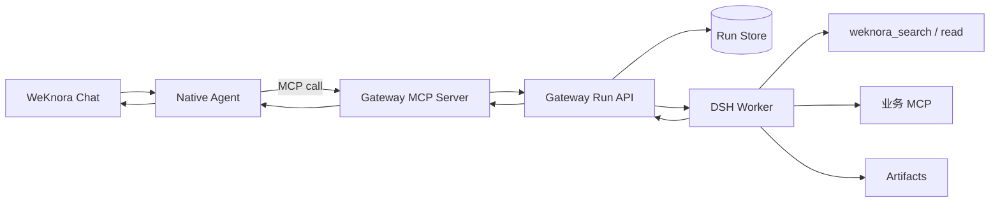

# 子设计 A：DeepSeek Harness Gateway MCP 接入与 Runtime Adapter 演进方案

> 版本：V2.0  
> 日期：2026-09-29  
> 上位方案：[`00-pg-ai-foundation-master-implementation-plan.md`](00-pg-ai-foundation-master-implementation-plan.md)  
> 一期策略：独立 Gateway + MCP，尽量不修改 WeKnora Go 后端  
> 二期策略：达到触发条件后，可选增加 Runtime Adapter

## 1. 结论

DeepSeek Harness 不直接嵌入 WeKnora，也不在一期新增 `DeepSeekHarnessExecutor`。新增独立服务 `dsh-runtime-gateway`，它同时提供稳定的内部 HTTP API 和 MCP Server：

```text
WeKnora Native Agent
  → Gateway MCP
  → dsh-runtime-gateway
  → DeepSeek Harness Worker
```

一期的收益是部署边界清晰、DSH SDK 升级与 WeKnora 隔离，并且可以直接复用 WeKnora 已有的 MCP 管理和 Agent 工具调用能力。其限制是 DSH 内部步骤不能完整映射到 WeKnora `AgentStep`；长任务采用“创建 run、查询状态、读取结果”，停止与恢复通过 MCP 工具完成。

未来若必须在原聊天中展示完整 DSH 流式步骤，再新增薄 `Runtime Adapter`。Adapter 继续调用 Gateway，而不是直接依赖 DSH SDK。

## 2. 当前代码依据

WeKnora 当前已经具备：

| 能力 | 代码位置 |
|---|---|
| Native Agent 接口 | `internal/types/interfaces/agent.go` |
| Native ReAct 实现 | `internal/agent/engine.go` |
| Agent 工厂 | `internal/application/service/agent_service.go` |
| 会话编排 | `internal/application/service/session_agent_qa.go` |
| MCP 管理和调用 | `internal/application/service/mcp_service.go`、`internal/mcp/*` |
| Agent MCP 范围 | `session_agent_qa.go` 的 MCP selection/pinned scope |
| SSE / 事件 | `internal/event/*` |

因此一期只需要把 Gateway MCP 注册到 WeKnora，并在指定 Agent 模板中启用相关工具。无需抽象原生 Executor，也无需修改 `session_agent_qa.go`。

## 3. 一期架构



### 3.1 单轮角色

- Native Agent 是主管 Agent：理解用户、决定是否委托、最终汇总。
- DSH Worker 是工作 Agent：执行一次有明确 scope 的复杂任务。
- Gateway 是运行控制层：创建、幂等、状态、取消、恢复、结果和版本隔离。
- WeKnora 仍拥有用户、租户、会话、最终回答和知识库。

这是有意设计的“主管 Agent → 工作 Agent”模式。两个推理循环不会同时直接回答用户，也不允许 DSH 反向调用 WeKnora Agent 形成循环。

## 4. Gateway 服务边界

### 4.1 Gateway 负责

1. 屏蔽 DSH SDK、进程模型和版本差异。
2. 校验服务凭据、scope、工具白名单和资源限制。
3. 创建唯一 run，保存 idempotency key 和状态。
4. 启动、取消、恢复 DSH Worker。
5. 标准化事件、错误、用量和产物索引。
6. 为 MCP 和未来 Runtime Adapter 提供同一套 API。

### 4.2 Gateway 不负责

- 不保存 WeKnora 用户密码或登录 Token。
- 不成为需求、本体或部署事实源。
- 不自动确认 ChangeSet 或发布本体。
- 不绕过 WeKnora/星火的租户与项目权限。
- 不向用户提供第二套聊天页面。

## 5. HTTP API 契约

### 5.1 创建 run

```http
POST /internal/v1/runs
Authorization: Bearer <service-token>
Idempotency-Key: <tenant:session:message:tool-call>
Content-Type: application/json
```

```json
{
  "principal": {
    "tenantId": "10000",
    "userId": "user-id",
    "projectId": "project-id"
  },
  "source": {
    "sessionId": "weknora-session-id",
    "messageId": "assistant-message-id",
    "agentId": "custom-agent-id"
  },
  "profile": "requirement-analysis",
  "query": "分析需求并检查代码影响",
  "scope": {
    "knowledgeBaseIds": ["kb-id"],
    "allowedTools": [
      "weknora_search",
      "weknora_read_document",
      "ontology_get_project_state"
    ],
    "workspaceRef": "project-id@commit"
  },
  "limits": {
    "timeoutSeconds": 1800,
    "maxToolCalls": 80,
    "maxOutputBytes": 1048576
  }
}
```

成功时快速返回：

```json
{
  "runId": "run_01...",
  "status": "queued",
  "createdAt": "2026-09-29T10:00:00+08:00",
  "statusUrl": "/internal/v1/runs/run_01..."
}
```

### 5.2 查询、结果、取消和恢复

```text
GET  /internal/v1/runs/{run_id}
GET  /internal/v1/runs/{run_id}/result
GET  /internal/v1/runs/{run_id}/events?after={cursor}
POST /internal/v1/runs/{run_id}/cancel
POST /internal/v1/runs/{run_id}/resume
```

状态机：

```text
queued → running → waiting_input → running → completed
                 ↘ failed
queued/running/waiting_input → cancelling → cancelled
```

终态必须不可逆。相同 `Idempotency-Key` 和相同请求摘要返回同一个 run；相同 key 但请求摘要不同返回 409。

### 5.3 标准事件 envelope

```json
{
  "runId": "run_01...",
  "cursor": "00000042",
  "sequence": 42,
  "occurredAt": "2026-09-29T10:00:03.125+08:00",
  "type": "run.started|thinking.delta|tool.started|tool.finished|artifact.created|input.required|answer.delta|run.completed|run.failed",
  "data": {}
}
```

一期可以只将状态摘要和最终结果返回给 WeKnora；事件模型必须从第一天固定，以便未来 Adapter 使用 cursor 恢复。

## 6. MCP 工具设计

| 工具 | 行为 | 最大等待 |
|---|---|---|
| `dsh_create_run` | 创建任务并快速返回 run_id | 5–10 秒 |
| `dsh_get_run` | 返回状态、进度和错误摘要 | 5 秒 |
| `dsh_get_result` | 仅在终态返回结果、引用和产物 | 10 秒 |
| `dsh_cancel_run` | 幂等取消 | 10 秒 |
| `dsh_resume_run` | 为 `waiting_input` 提交补充输入 | 10 秒 |

### 6.1 为什么不提供单个 `dsh_execute` 长阻塞工具

- MCP、反向代理和模型工具调用都可能超时。
- 断线重试可能重复执行副作用任务。
- 无法让用户稍后查询或取消。
- 长连接占用 Native Agent 当前轮次和模型上下文。

### 6.2 Agent 工具使用规则

```text
只有需要多步骤代码、工作区或跨系统分析时才调用 dsh_create_run。
普通知识检索直接使用 WeKnora 知识工具。
创建 run 后保存 runId；不得为同一任务重复创建 run。
run 未完成时返回任务状态，不编造结果。
DSH 工具不得调用带 agentId 的 weknora_ask。
```

## 7. 知识与业务工具接入

DSH Worker 可使用：

- `weknora_search`
- `weknora_read_document`
- `weknora_list_knowledge_bases`（仅授权范围）
- 需求/本体内部草稿 MCP
- 项目 Git、代码图谱、Sandbox 工具

不建议在 DSH Worker 中使用 `weknora_ask(agentId)`。否则调用链会变为 DSH → WeKnora Agent → Gateway MCP → DSH，可能形成递归、重复执行和无法解释的计费。

每个 run 注入的工具必须是 allowlist 的交集：

```text
Gateway profile allowlist
∩ Agent template allowlist
∩ tenant/project policy
∩ 当前用户权限
= effective tools
```

## 8. 安全和租户隔离

1. WeKnora 用户 Token 不传给 DSH Worker。
2. Gateway MCP 使用服务凭据；创建 run 时传递经过校验的最小 principal/scope。
3. Gateway 为下游工具签发短期 capability token，包含 tenant/user/project/run/tools/expiry/nonce。
4. 下游 MCP 仍需再次验证项目权限和工具权限。
5. Gateway 和 Worker 不挂载 Docker Socket；需要 Sandbox 时使用受控后端。
6. 写工具默认关闭；候选写工具必须幂等，确认/发布工具不得暴露。
7. 日志不记录 API Key、Bearer Token、完整附件正文或未裁剪工具返回。
8. 产物使用短期签名 URL，且必须校验 tenant/project/run。

## 9. 持久化与部署

### 9.1 组件

```text
dsh-runtime-gateway
├─ HTTP Run API
├─ MCP Server
├─ DSH Adapter
├─ Run Repository
├─ Event Repository
├─ Capability Issuer
└─ Worker Dispatcher
```

### 9.2 存储职责与部署约束

- PostgreSQL：run、idempotency、事件游标、终态、产物索引；作为 Gateway 任务状态的持久化事实源，支持任务查询和重启恢复。
- Redis：分布式锁、短期状态、队列；不能作为唯一事实源。
- 对象存储/受控文件目录：大产物。

#### 9.2.1 现网基线（2026-09-30 只读核对）

WeKnora 与星火同机部署，但 PostgreSQL、Redis 均不共用实例。星火业务主库是 MySQL，知识库另用 PostgreSQL。

| 用途 | 现网实例 / 容器 | 数据库 |
|---|---|---|
| WeKnora PostgreSQL | WeKnora-postgres | WeKnora |
| 星火知识库 PostgreSQL | mem0-postgres-1 | knowledge_base |
| 星火业务 MySQL | pangu-mysql（宿主机 3308） | system_base |
| WeKnora Redis | WeKnora-redis（Redis 7） | DB 0 |
| 星火 Redis | redis（Redis 6.2，宿主机 6379） | DB 编号本次未核对；实例与 WeKnora 独立 |

#### 9.2.2 一期固定部署约束

1. **PostgreSQL 固定复用 `WeKnora-postgres` 实例**，新建独立 database `dsh_runtime` 和专用最小权限账号；不得仅在 `WeKnora` 库内另建 schema 代替独立库，也不得复用 WeKnora 的 `postgres` 超级用户凭据。
2. **Redis 固定复用 `WeKnora-redis` 实例**，使用经部署前核验未占用的独立 DB 编号，所有 Gateway key 使用 `dsh:` 前缀。不得使用 WeKnora 的 DB `0`；若启用 Langfuse，还须避开其实际 DB（默认 `1`）。DB `2` 仅为候选值，确认未占用后才能配置。
3. Gateway 的数据库迁移、迁移记录和按库备份/恢复独立管理；只读写 `dsh_runtime`，不得直连或读写 WeKnora、星火业务表。知识和业务访问通过授权的 WeKnora API / 星火 API、MCP 完成。
4. 一期不新增 PG、Redis 实例，不合并或迁移星火现有数据库。共享实例仍共享 CPU、内存和故障影响范围；Redis DB 编号与前缀仅提供逻辑隔离，不是资源或安全隔离。实例升级需协调，Gateway 连接数与任务并发需受控；后续可将 `dsh_runtime` 独立迁出。

#### 9.2.3 存储验收

- 部署记录包含实际 PG 实例、`dsh_runtime` 库名、专用账号名、Redis 实例、已核验的 DB 编号和 `dsh:` 前缀，不记录密码。
- 验证 Gateway 账号只能访问获授权的 `dsh_runtime` 对象，无权读写 WeKnora 或星火业务表；Gateway 迁移不修改其他库。
- 验证 Gateway Redis key 与队列使用指定 DB 和前缀，不占用 WeKnora 或 Langfuse 的 DB；运维不得对共享 Redis 执行 `FLUSHALL`。
- 验证 Gateway 重启后仍可从 PostgreSQL 查询已接受的 run、幂等记录、事件游标、终态和产物索引；锁和缓存不承担唯一持久化职责。
- 完成 `dsh_runtime` 按库备份及恢复演练，并验证共享实例上的其他业务数据不被改写。

### 9.3 容器和网络

```text
weknora-backend  ──MCP/HTTP──> dsh-runtime-gateway
dsh-runtime-gateway ──dispatch──> dsh-worker(s)
dsh-worker(s) ──scoped tools──> WeKnora API / 星火 MCP
```

Gateway 只在内部网络开放；健康检查分为：

- `/healthz`：进程存活。
- `/readyz`：数据库可用、能接受新 run。
- `/internal/v1/capabilities`：支持的 profile、事件版本和功能。

## 10. WeKnora 一期配置

在 WeKnora 管理页注册 Gateway MCP：

```text
名称：DeepSeek Harness Runtime Gateway
Transport：Streamable HTTP
URL：http://dsh-runtime-gateway:<port>/mcp
Auth：服务 Token / 自定义 Header
```

为首批内部 Agent 选择 Gateway MCP，并按模板限制可用工具。普通 Agent 和共享 Agent 默认不启用。

一期不增加：

- `execution_backend` 字段。
- Agent 编辑器 Runtime 下拉。
- `AgentExecutorRegistry`。
- `DeepSeekHarnessExecutor`。
- DSH 事件到 WeKnora EventBus 的映射。

## 11. 未来 Runtime Adapter

### 11.1 触发条件

以下任一成为正式需求时再实施：

- 原聊天必须实时展示 DSH 的思考、工具和产物步骤。
- WeKnora 停止按钮必须直接取消当前 DSH run。
- 断线后必须从 cursor 恢复同一 run 的事件流。
- DSH 任务成为多数流量，MCP 主管/工作模式延迟或 Token 成本不可接受。
- DSH step 必须进入 WeKnora 原生消息持久化和任务检查器。

### 11.2 Adapter 抽象

```go
type RuntimeAdapter interface {
    Backend() string
    Start(context.Context, RuntimeRequest) (RunHandle, error)
    Stream(context.Context, string, string) (<-chan RuntimeEvent, error)
    Cancel(context.Context, string) error
    Resume(context.Context, string, RuntimeInput) error
    Result(context.Context, string) (RuntimeResult, error)
}
```

实现层级：

```text
RuntimeAdapter
├─ NativeRuntimeAdapter       # 包装现有 AgentEngine
└─ DeepSeekHarnessAdapter     # 只调用 Gateway HTTP API
```

### 11.3 未来代码落点

```text
internal/types/runtime.go
internal/types/interfaces/runtime_adapter.go
internal/application/service/runtime_registry.go
internal/application/service/native_runtime_adapter.go
internal/application/service/deepseek_harness_adapter.go
internal/infrastructure/dshgateway/client.go
internal/infrastructure/dshgateway/stream.go
```

届时才修改：

```text
internal/application/service/session_agent_qa.go
internal/container/container.go
internal/types/custom_agent.go
frontend/src/views/agent/AgentEditorModal.vue
```

### 11.4 兼容要求

- 旧 Agent 默认 Native。
- `quick-answer` 不进入 Runtime Registry。
- 前端 SSE 仍以 WeKnora EventBus 为唯一协议。
- DSH run 创建后不得自动回退 Native。
- Gateway HTTP/MCP 契约保持向后兼容。

## 12. 实施步骤

### A0：契约与假服务

- 定义 OpenAPI、MCP schema、状态机、事件 envelope 和错误码。
- 使用 fake DSH Adapter 验证幂等、取消、恢复和事件游标。
- 不接真实 DSH，不修改 WeKnora。

### A1：Gateway 核心

- 实现 run repository、idempotency、dispatcher 和结果持久化。
- 实现健康检查、能力接口、审计和指标。

### A2：真实 DSH Adapter

- 封装 DSH SDK/CLI/API。
- 将 DSH 事件转换为标准 envelope。
- 接入资源限制、Sandbox 和产物。

### A3：Gateway MCP

- 实现五个 MCP 工具。
- 注册到测试租户和内部 Agent。
- 验证 Native 主管 Agent 的委托提示词。

### A4：知识与业务工具

- 接入 `dsh-weknora` search/read。
- 接入草稿 MCP 和项目 scope。
- 验证跨租户、跨项目和工具越权。

### A5：灰度

- 首批只开需求分析和本体影响分析。
- 观察创建成功率、排队、完成率、P95 时长、取消和重复 run。
- 保留一键禁用 Gateway MCP 的开关。

### A6（可选）：Runtime Adapter

仅在第 11.1 节触发条件成立后实施，并作为独立版本发布。

## 13. 验收矩阵

| 场景 | 预期 |
|---|---|
| 相同 key 重复创建 | 返回同一 run |
| 相同 key 不同请求 | 409，不执行第二次 |
| DSH 不可用 | run 明确失败，Native 不编造结果 |
| Worker 处理中崩溃 | 状态可恢复或进入明确失败终态 |
| 用户取消 | 幂等取消，后续工具不再执行 |
| waiting_input | 可用 resume 提交一次补充输入 |
| Gateway MCP 超时 | create 已持久化时可用相同 key 查询原 run |
| 越权 KB/Tool | 下游拒绝并写审计 |
| DSH 试图调用 `weknora_ask(agentId)` | 工具不在 allowlist |
| Gateway 禁用 | Native Agent 继续完成普通知识任务 |
| WeKnora 升级 | MCP 注册和工具契约回归通过 |

## 14. 监控指标

```text
gateway_runs_total{profile,status,tenant}
gateway_run_duration_seconds{profile,status}
gateway_queue_wait_seconds{profile}
gateway_tool_calls_total{tool,status}
gateway_idempotency_replays_total
gateway_cancel_latency_seconds
gateway_worker_restarts_total
gateway_event_lag_seconds
gateway_artifact_bytes_total
```

日志关联键：`tenant_id`、`user_id`、`project_id`、`session_id`、`message_id`、`request_id`、`tool_call_id`、`run_id`。敏感内容只记录 hash 或裁剪摘要。

## 15. 完成定义

一期完成需满足：

1. Gateway 作为独立服务部署并通过健康检查。
2. WeKnora 仅通过 MCP 配置接入，没有 DSH 相关 Go 主链路改动。
3. Native Agent 能创建、查询、读取结果、取消和恢复 DSH run。
4. run 幂等、终态、错误和产物可持久化。
5. DSH 只能访问授权知识库、项目和工具。
6. 普通知识问答在 Gateway 不可用时仍正常工作。
7. 事件 envelope 和 HTTP API 可支持未来 Runtime Adapter。
8. Runtime Adapter 保持未启用，直到业务触发条件成立。
9. 第 9.2 节存储隔离、持久化和备份恢复验收通过，记录实际 Redis DB 编号。


## 16. 首轮实现边界与进度（2026-09-30）

独立代码仓库：[yule1104/dsh-gateway](https://github.com/yule1104/dsh-gateway)。本地实现与验收记录见 [`dsh-gateway/docs/implementation-status.md`](../../dsh-gateway/docs/implementation-status.md)。

本轮用户已确认：

1. 先使用每个内部 Agent 的专用服务凭据，由 Gateway 服务端固定绑定 tenant/user/project/Agent/KB/tool allowlist；MCP 不接受模型指定 principal。动态 BFF 授权留待后续。静态凭据不能代表任意当前登录用户，联调时必须限制该 Agent/MCP 的可见范围。
2. 先完成开发和本地验证，再开展服务器联调。不得修改或影响本机、服务器已有 DSH 安装、配置、插件及星火进程。
3. 首轮只做需求分析、本体影响分析的只读知识版本。星火草稿写入、Git/Sandbox 执行留待后续接口与权限确认。

实现说明：

- HTTP/MCP 共用 run 服务；PG 保存任务、事件、幂等和产物索引，并使用行锁、持久化队列和 Worker 租约。Redis 仅承担短期协调，不承担唯一队列/锁或事实源。
- 真实 DSH Adapter 针对 0.1.5-rc.1 的 SDK stdio 协议验证；每次启动独立 HOME/DSH_HOME/workspace，仅加载受限知识工具和补充输入控制工具，不加载 shell、文件写入或业务执行工具。
- waiting_input 的问题通过查询接口直接返回；用户等待不消耗执行时限。resume 从 PG 中的任务、先前分析及补充输入重建只读执行，不等同于恢复原生 DSH 会话。Worker 崩溃进入明确失败终态，不自动重放。
- 复用固定版本 dsh-weknora，额外校验知识库范围与文档归属；知识 API Key 留在 Gateway 父进程，Worker 使用 run 范围的短期 capability。
- Markdown 分析产物保存到受控目录，PG 保存索引和摘要；短期下载链接仍要求匹配身份的服务凭据，浏览器访问留待 BFF 代理。

本地验证不替代现网验收：独立数据库/账号创建、Redis DB 编号核验、真实 PG 多连接与权限测试、备份恢复、WeKnora 注册和测试租户灰度，均须在服务器联调阶段单独完成。A5 不因本地测试通过而视为已上线。
