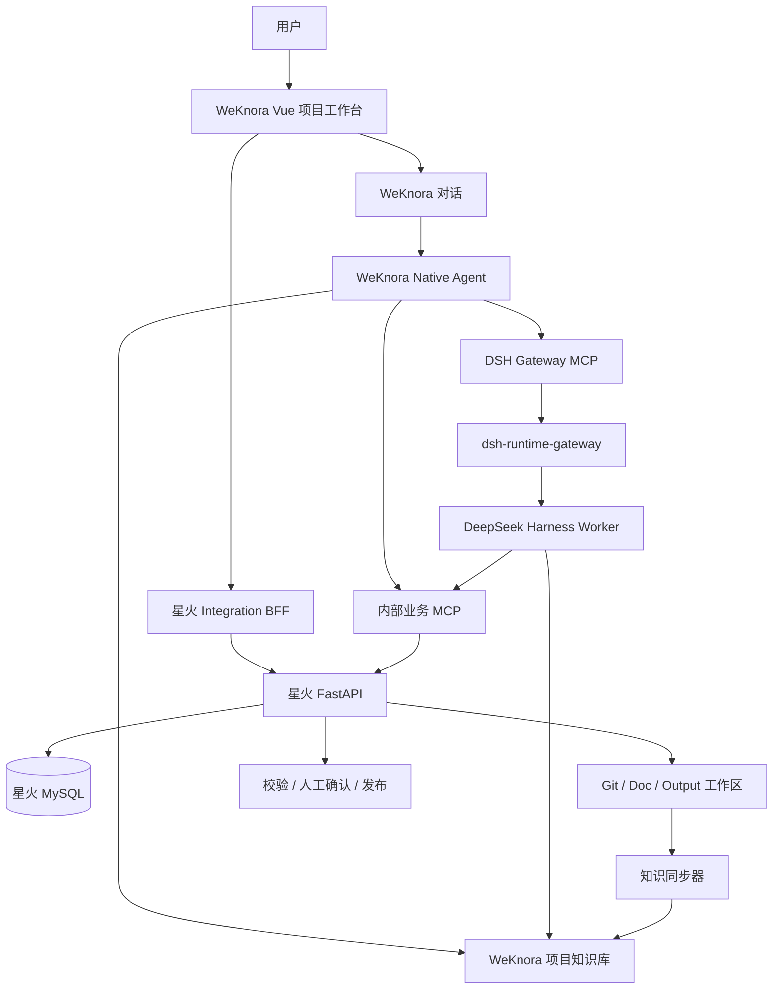

# 子设计 B：星火平台能力迁移到 PG-AI-Foundation 技术方案

> 版本：V2.0  
> 日期：2026-09-29  
> 上位方案：[`00-pg-ai-foundation-master-implementation-plan.md`](00-pg-ai-foundation-master-implementation-plan.md)  
> 目标：以 WeKnora 作为统一产品框架，迁移星火平台的项目、需求、本体、项目资料和部署能力  
> 阶段策略：迁移前端与入口，复用星火后端服务和数据库；Integration BFF 放在星火 FastAPI，复杂任务通过 DSH Gateway MCP 接入

代码基线：`WeKnora-dsh/main@0c6b30cfa705c1d2f2ccd084cd76174738a7fb4b`。服务器当前 WeKnora 镜像 revision 为 `3e8b0bfc80b845b2d4b2ed683994748741450a97`，开发仓库前进 93 个提交；上线前必须先完成纯升级演练。

## 1. 方案定位

本子设计受总方案 P0–P6 顺序约束，不能单独发展第二套聊天或 DSH Runtime。业务迁移包含：

1. 将需求管理、本体模型、项目资料和部署页面迁移到 WeKnora 前端框架。
2. 继续复用星火现有后端服务和数据库。
3. 将本体查询和候选变更封装为 MCP。
4. 由 WeKnora Native Agent 负责对话、分析和生成候选；复杂任务通过 Gateway MCP 委托 DSH。
5. 现有本体服务继续负责校验、确认和发布。

该路径合理可行。需要补充三个边界：

- 星火前端是 React 19 + Ant Design，WeKnora 是 Vue 3 + TDesign，页面需要按 WeKnora 组件体系重写，不能直接复制 TSX。
- 现有公开本体 MCP 是“固定发布版本、只读查询”。候选变更应新增内部草稿 MCP；确认和发布仍走受 RBAC、版本哈希和人工操作保护的业务 API。
- 一期不在 WeKnora Go 中增加星火 BFF 或 DSH Executor。项目页请求由 Nginx 同源转发到星火 Integration BFF；DSH 只通过独立 Gateway MCP 接入。

## 2. 现状依据

### 2.1 WeKnora

| 模块 | 技术与能力 |
|---|---|
| 前端 | Vue 3、TypeScript、Vite、Pinia、Vue Router、TDesign |
| 后端 | Go，租户、用户、知识库、Agent、MCP、Skill、Sandbox、SSE |
| Agent | quick-answer RAG + smart-reasoning ReAct |
| 知识 | 文档解析、混合检索、引用、知识图谱 |

### 2.2 星火现有平台 `system-platform`

| 模块 | 当前实现 |
|---|---|
| 前端 | React 19、Vite、Ant Design |
| 后端 | Python 3.12、FastAPI、SQLAlchemy |
| 数据 | MySQL、Redis，`biz_ontology_*` 等业务表 |
| Agent Runtime | `AgentExecutor` 抽象，已有 `LlmDirectExecutor` 和 `DshExecutor` |
| 本体入口 | `backend/app/routers/ontology.py` |
| 本体服务 | `ontology_service.py`、`ontology_change_service.py`、`ontology_delivery.py` |
| 本体 MCP | `backend/app/routers/ontology_mcp.py`，固定 Release Token、只读 |
| 项目资料 | `project_workspace*`、`project_source_service.py`、`project_retrieval.py` |
| 部署 | `project_deploy.py`、`project_deploy_service.py` |
| 主页面 | `frontend/src/views/ontology/index.tsx` |

现有星火代码已经具备 DSH 执行器、项目工具网关、需求候选、证据校验和人工确认机制。项目、候选、校验和人工确认等领域能力应优先复用；原 `DshExecutor` 只在迁移期兼容，新增任务统一进入 Gateway。

## 3. 目标边界

| 组件 | 第一阶段职责 |
|---|---|
| WeKnora 前端 | 统一导航、项目工作台、需求/本体/资料/部署页面、对话入口 |
| WeKnora 后端 | 登录与租户、Agent、知识库、MCP 注册、SSE；一期保持 Go Agent 主链路不变 |
| 星火 Integration BFF | WeKnora 身份校验、项目空间绑定、页面 API、错误码、幂等与审计 |
| 星火后端 | 项目、Git、需求、本体、候选、校验、确认、发布、部署业务规则 |
| 星火数据库 | 业务事实源，不迁表、不与 WeKnora 表直连 |
| WeKnora 知识库 | 项目文档和可检索快照，服务 RAG/Agent，不取代业务数据库 |
| 内部本体 MCP | 查询草稿/发布数据，创建和校验候选变更 |
| WeKnora Agent | 理解用户、检索资料、分析、生成候选；不自动确认或发布 |
| DSH Runtime Gateway | 独立 run 生命周期、幂等、取消、恢复、DSH 版本隔离和 MCP |
| DeepSeek Harness | 复杂、多步骤、跨代码/资料任务的工作 Agent |

## 4. 目标架构



## 5. 项目空间与身份映射

WeKnora 租户、空间、知识库与星火项目需要显式绑定。为保持 WeKnora Go 后端接近上游，绑定表由星火 Integration BFF 管理，存放在星火数据库的独立集成 schema/table：

```text
project_space_binding
├─ id
├─ tenant_id
├─ weknora_space_id / knowledge_base_id
├─ xinghuo_project_id
├─ requirement_agent_id
├─ ontology_agent_id
├─ project_agent_id
├─ sync_status
├─ last_synced_revision
├─ created_by
├─ created_at
└─ updated_at
```

约束：

- `(tenant_id, xinghuo_project_id)` 唯一。
- BFF 每次调用携带浏览器已有的 WeKnora Bearer Token，调用 `/api/v1/auth/me` 校验用户、当前租户与会话有效性，再校验星火项目成员关系。
- 浏览器不保存星火服务密钥。
- Nginx 将 `/api/pg-platform/*` 同源转发到星火 Integration BFF，浏览器无需处理跨域。
- 不根据前端传入的 `projectId` 直接授权。

## 6. 前端迁移方案

### 6.1 迁移方式

从现有 React 页面提取以下内容：

- 页面信息架构和交互流程。
- API 请求/响应契约。
- 状态机、校验规则和错误文案。
- 权限点和按钮显隐规则。

在 WeKnora 中使用 Vue 3 + TDesign 重写：

```text
frontend/src/views/project-space/
├─ ProjectWorkspace.vue
├─ tabs/
│  ├─ RequirementsTab.vue
│  ├─ OntologyModelTab.vue
│  ├─ ProjectSourcesTab.vue
│  └─ DeploymentTab.vue
├─ components/
│  ├─ RequirementDetailDrawer.vue
│  ├─ OntologyTree.vue
│  ├─ CandidateChangeReview.vue
│  ├─ ProjectBindingPanel.vue
│  └─ DeploymentStatusPanel.vue
└─ composables/
   ├─ useProjectBinding.ts
   ├─ useRequirements.ts
   ├─ useOntology.ts
   └─ useDeployment.ts
```

API 建议：

```text
frontend/src/api/xinghuo-project.ts
frontend/src/types/xinghuo-project.ts
```

### 6.2 页面映射

| 星火页面/组件 | WeKnora 目标页 | 第一阶段处理 |
|---|---|---|
| `ontology/index.tsx` | `ProjectWorkspace.vue` | 拆分为四个 Tab，保留业务流程 |
| 需求管理 | `RequirementsTab.vue` | 列表、详情、编辑、确认、去对话 |
| 本体模型 | `OntologyModelTab.vue` | 树、节点详情、来源、候选变更审核 |
| `ProjectSourcesDrawer.tsx` | `ProjectSourcesTab.vue` | Git、Doc、Output、同步状态 |
| `ProjectDeployPanel.tsx` | `DeploymentTab.vue` | 配置、状态、日志、启动/停止入口 |
| `ProjectAgentChat.tsx` | WeKnora 原生 Chat | 不迁移第二套聊天 UI；用 Agent 与会话扩展 |

## 7. 星火 Integration BFF

推荐在星火现有 FastAPI 中增加 Integration BFF 模块，由 Nginx 提供同源路径。这样浏览器仍只登录 WeKnora，WeKnora Go 后端无需承载星火领域 API。

```text
backend/app/routers/pg_platform.py
backend/app/services/weknora_identity.py
backend/app/services/project_space_binding.py
backend/app/schemas/pg_platform.py
backend/app/models/project_space_binding.py
```

外部接口示例：

```text
GET    /api/pg-platform/spaces/:space_id/binding
PUT    /api/pg-platform/spaces/:space_id/binding
GET    /api/pg-platform/spaces/:space_id/requirements
GET    /api/pg-platform/spaces/:space_id/ontology/state
GET    /api/pg-platform/spaces/:space_id/sources
POST   /api/pg-platform/spaces/:space_id/sources/sync
GET    /api/pg-platform/spaces/:space_id/deployment
POST   /api/pg-platform/spaces/:space_id/deployment/actions
```

BFF 只做：

- 使用 WeKnora `/api/v1/auth/me` 校验 Bearer Token、用户和租户。
- 项目绑定与项目成员权限校验。
- 请求/响应适配。
- 错误码统一。
- 审计与幂等键。

本体版本、需求状态、发布门禁等业务逻辑继续留在星火后端。

## 8. 项目资料与知识库同步

星火工作区保留：

```text
/data/system-platform-project/<immutable-project-id>/
├─ git/
├─ doc/
└─ output/
```

WeKnora 每个项目空间绑定独立知识库。同步器将可检索资料写入 WeKnora：

```text
星火 Git/Doc/Output
    → 生成文件清单与 content_hash
    → 检查 WeKnora external_id
    → 新增/更新/删除知识文档
    → 保存 source_revision 与 sync_result
```

建议元数据：

```json
{
  "external_id": "xinghuo:<projectId>:<sourceType>:<sourceId>",
  "project_id": "...",
  "source_type": "git|doc|output",
  "source_revision": "commit-or-version",
  "path": "...",
  "content_hash": "sha256:...",
  "visibility": "project",
  "synced_at": "..."
}
```

知识库是检索副本。需求确认、本体版本和部署状态仍从星火 API 实时读取。

## 9. 本体 MCP 拆分

### 9.1 保留现有发布版 MCP

现有 `backend/app/routers/ontology_mcp.py` 使用独立 Release Token，读取冻结的 manifest 和发布版本，适合外部、稳定、只读查询。继续保留：

```text
/api/mcp/ontology
```

### 9.2 新增内部草稿 MCP

新增服务间入口：

```text
/api/mcp/internal/ontology-draft
```

建议工具：

| 工具 | 类型 | 说明 |
|---|---|---|
| `ontology_get_project_state` | 读 | 读取草稿/发布指针、版本和阻断项 |
| `ontology_search_nodes` | 读 | 按关键词、类型和关系查询节点 |
| `ontology_get_node` | 读 | 查看节点、来源、版本与关联 |
| `ontology_get_requirement` | 读 | 读取需求、规格、澄清和确认状态 |
| `ontology_create_candidate` | 候选写 | 创建候选 ChangeSet，不应用、不确认 |
| `ontology_validate_candidate` | 读/校验 | 运行冲突、来源、哈希和发布门禁检查 |
| `ontology_list_pending_candidates` | 读 | 查看待人工确认候选 |

明确不提供给 Agent：

- `confirm_requirement`
- `confirm_changeset`
- `publish_release`
- `delete_project`
- 生产部署确认

这些动作继续由页面按钮调用受保护的星火业务 API。

### 9.3 内部 MCP 认证

- 仅允许 WeKnora/DSH 服务网络访问。
- 使用短期签名票据，包含 tenant、user、project、agent、tool allowlist、过期时间。
- 每个工具再次调用 `ontology_access` 验证项目权限。
- 创建候选必须有 `request_id`、`expected_hash`、来源引用和审计操作者。

## 10. Agent 设计

### 10.1 Agent 划分

| Agent | 一期执行方式 | 知识/工具 | 结果 |
|---|---|---|---|
| 项目知识助手 | Native | 项目 KB、只读 MCP | 回答与引用 |
| 需求 Agent | Native；复杂分析调用 Gateway MCP | 项目 KB、需求读、候选创建 | 澄清问题、需求候选 |
| 本体 Agent | Native 主管 + Gateway MCP | 项目 KB、本体查询、候选创建/校验 | 本体 ChangeSet 候选 |
| 编码 Agent | Native 主管 + Gateway MCP | Git/Doc、代码图谱、Sandbox | 计划、代码或交付物 |
| 部署 Agent | Native 主管 + Gateway MCP | 部署资料、受限执行工具 | 部署候选与执行记录 |

### 10.2 需求 Agent 提示词约束

```text
你负责澄清、分析并生成需求候选。
所有结论必须引用项目资料或明确标为假设。
信息不足时输出待确认问题。
只允许创建候选，不得确认需求、发布本体或执行部署。
```

### 10.3 本体 Agent 提示词约束

```text
先读取当前本体版本、需求和证据，再生成 ChangeSet 候选。
候选必须携带 expectedHash、来源引用和影响说明。
调用 validate 工具后返回冲突与缺口。
不得调用确认或发布动作。
```

### 10.4 对话入口

WeKnora 原生 Chat 是唯一正式对话入口：

- 进入项目空间时自动携带 `project_space_binding`。
- 选择需求/本体 Agent 时注入项目 KB 和内部 MCP。
- 生成候选后，聊天卡片提供“查看候选”跳转。
- 用户在业务页面完成校验、编辑、确认和发布。

## 11. 业务状态与人工门禁

推荐状态：

```text
AI 分析
  → candidate
  → validating
  → pending_review
  → confirmed
  → published
```

控制规则：

1. AI 只能到 `candidate` 或 `pending_review`。
2. `confirmed` 需要用户权限、期望哈希和当前修订一致。
3. `published` 继续执行现有来源、澄清、冲突和版本门禁。
4. 候选过期或基础版本变化时返回 409，不静默覆盖。
5. 所有确认、拒绝和发布写审计记录。

## 12. 数据所有权

| 数据 | 唯一事实源 | WeKnora 保存内容 |
|---|---|---|
| 用户/租户/会话 | WeKnora | 完整数据 |
| 项目业务信息与空间绑定 | 星火 | 前端只保存瞬时展示状态 |
| Git 仓库与同步任务 | 星火 | 状态摘要、知识文档副本 |
| 需求与规格 | 星火 | 对话引用、知识快照 |
| 本体草稿/版本/ChangeSet | 星火 | Agent 上下文与引用 |
| 确认与发布 | 星火 | 操作结果和链接 |
| 项目知识文档 | WeKnora | 可检索正文、元数据、版本 |
| Agent 配置与对话 | WeKnora | 完整数据 |
| DSH run | Gateway/DSH | WeKnora 对话只保存 run ID、摘要和最终结果 |

禁止方案：

- WeKnora 直接读写星火 MySQL。
- 把 `biz_ontology_*` 表复制进 WeKnora 数据库后双写。
- 让 Agent 直接调用确认/发布数据库操作。
- 同时保留星火 Chat 和 WeKnora Chat 面向普通用户。

## 13. 文件级改造清单

### 13.1 WeKnora-dsh 前端新增

```text
frontend/src/api/xinghuo-project.ts
frontend/src/types/xinghuo-project.ts
frontend/src/views/project-space/ProjectWorkspace.vue
frontend/src/views/project-space/tabs/RequirementsTab.vue
frontend/src/views/project-space/tabs/OntologyModelTab.vue
frontend/src/views/project-space/tabs/ProjectSourcesTab.vue
frontend/src/views/project-space/tabs/DeploymentTab.vue
```

一期不在 WeKnora `internal/` 下增加星火 BFF 或 DSH Runtime 代码。

### 13.2 星火后端新增/调整

```text
backend/app/routers/pg_platform.py
backend/app/models/project_space_binding.py
backend/app/schemas/pg_platform.py
backend/app/services/project_space_binding.py
backend/app/routers/ontology_draft_mcp.py
backend/app/services/ontology_draft_tools.py
backend/app/services/weknora_identity.py
backend/app/routers/project_workspace.py（补充同步状态契约）
backend/app/services/project_workspace_sync.py（补充 revision/hash）
```

复用且保持业务所有权：

```text
backend/app/services/ontology_service.py
backend/app/services/ontology_change_service.py
backend/app/services/ontology_delivery.py
backend/app/services/project_deploy_service.py
backend/app/services/agent_executor.py
```

## 14. 在总方案 P0–P6 中的实施顺序

### P0：双基线与升级演练

- 固定 WeKnora fork、现网 revision、星火 commit 和数据库 schema。
- 固化星火 OpenAPI、错误码与关键页面样本。
- 先验证纯 WeKnora 升级，不加入本子设计代码。

验收：升级风险与迁移风险可以分别回归和回滚。

### P1：项目绑定、Integration BFF 和只读页面

- 在星火 FastAPI 中建立 `project_space_binding` 和 `/api/pg-platform/*`。
- 通过 WeKnora `/auth/me` 校验会话和租户，再校验项目权限。
- Vue/TDesign 重写四个 Tab 的只读部分。

验收：用户只登录 WeKnora 即可读取授权项目；越权项目返回 403。

### P2：DSH Gateway MCP

- 本阶段由子设计 A 实施独立 Gateway。
- 本子设计只提供项目、知识库和业务工具 scope，不新增第二套 Runtime。

验收：复杂分析能从 WeKnora 对话委托 DSH，星火原有 `DshExecutor` 不承接新增能力。

### P3：内部需求/本体草稿 MCP

- 保留现有发布版 MCP。
- 新建草稿查询、候选创建、校验和待审核工具。
- 接入短期票据、request ID、expected hash 和工具白名单。

验收：Native/DSH 能创建候选，无法确认或发布；跨项目调用被拒绝。

### P4：需求页面和需求 Agent

- 迁移需求列表、详情、编辑、候选审核和对话跳转。
- 项目知识、需求 MCP 与 Gateway MCP 组成需求 Agent 模板。
- 候选由用户在页面确认。

验收：从对话生成需求候选并完成人工确认闭环。

### P5：本体页面和本体 Agent

- 迁移本体树、节点、来源、版本和 ChangeSet 审核。
- Agent 使用 expected hash 创建候选并执行校验。
- 发布继续走星火业务服务和人工门禁。

验收：并发冲突被拒绝，Agent 无法绕过确认和发布。

### P6：项目资料、编码和部署

- Git/Doc/Output 增量同步到项目 KB。
- 编码任务经 Gateway MCP 使用 DSH 工作区和代码工具。
- 迁移部署状态、日志和受控操作页面。
- 先内部项目灰度，再按租户开启；旧前端转只读回查。

验收：主要业务在新入口闭环；旧页面不再产生新写入。

## 15. 测试与验收矩阵

| 领域 | 必测项 |
|---|---|
| 身份 | 租户、用户、项目成员、管理员、撤权后访问 |
| 绑定 | 重复绑定、跨租户绑定、项目删除、知识库删除 |
| BFF | `/auth/me` 失败、超时、星火 4xx/5xx、错误码映射、幂等 |
| 前端 | 四 Tab 的 loading/empty/error/permission 状态 |
| 知识同步 | 首次、增量、删除、重试、同 hash 幂等、引用版本 |
| MCP | 工具 schema、票据过期、工具白名单、跨项目、候选幂等 |
| Agent | 引用证据、信息不足提问、候选创建、拒绝自动确认 |
| 本体 | expected hash、冲突、人工确认、发布门禁、审计 |
| 部署 | 配置校验、确认、取消、失败、日志脱敏、重复点击 |
| 回滚 | 关闭功能开关后恢复旧入口，数据无双写损坏 |

## 16. AI 编码工具执行顺序

### Prompt 1：只做项目绑定和 BFF 骨架

```text
阅读总方案与本方案。只实现 P1 的 FastAPI Integration BFF、项目空间绑定和只读项目摘要。使用 WeKnora /auth/me 校验 Bearer Token 和 tenant，再校验星火项目权限。不要修改 WeKnora Go 后端。补充单元测试和 API 契约测试。
```

### Prompt 2：只迁移只读页面

```text
只实现 P1 的只读页面。参考 system-platform 的 React 页面交互和 API 契约，使用 Vue 3 + TDesign 重写 Requirements、Ontology、Sources、Deployment 四个只读 Tab。所有请求走 /api/pg-platform；不要复制 React TSX，不实现写操作，不新增聊天 UI。
```

### Prompt 3：项目知识同步

```text
只实现 P6 的知识同步子任务。将星火 Git/Doc/Output 的版本化资料增量同步到绑定的 WeKnora 知识库。使用 external_id + content_hash 幂等，记录 source_revision；不得同步密钥、构建产物和未授权路径。
```

### Prompt 4：内部本体 MCP

```text
只实现 P3。保留现有 /api/mcp/ontology 行为，新增内部草稿 MCP，提供查询、创建候选和校验工具。不得暴露确认、发布和删除工具。每个调用验证短期票据、project scope、tool allowlist、expected hash 和 request id。
```

### Prompt 5：Agent 闭环

```text
分别实施 P4 和 P5，不要一次同时迁移两个 Agent。Agent 使用 WeKnora Native 主管模式；复杂任务通过 Gateway MCP 委托 DSH。对话只能生成 candidate；结果跳转业务审核页。复用原生 Chat/SSE，不迁移 ProjectAgentChat.tsx。
```

## 17. 风险与控制

| 风险 | 控制 |
|---|---|
| React 页面硬搬到 Vue | 只迁交互与契约，按 TDesign 重写组件 |
| 两套认证 | 浏览器只登录 WeKnora；星火 BFF 通过 `/auth/me` 校验会话 |
| 双数据库一致性 | 业务数据只有星火事实源；WeKnora 只存绑定和知识副本 |
| Agent 越权写入 | MCP 只创建候选；确认和发布不作为 Agent 工具 |
| 草稿和发布版混淆 | 发布 MCP 与内部草稿 MCP 分端点、分 Token、分工具 |
| 知识库陈旧 | 保存 source revision，页面显示同步状态，关键状态实时查 API |
| DSH 重复执行 | Gateway idempotency key、run 恢复、工具幂等和人工门禁 |
| 大页面继续膨胀 | 将原 `ontology/index.tsx` 拆成独立 Vue Tab 和 composable |
| 两套 DSH Runtime | 星火原 `DshExecutor` 冻结；新增流量统一走 Gateway MCP |

## 18. 完成定义

第一阶段完成需要满足：

1. 用户在 WeKnora 内完成项目绑定并访问四个业务页面。
2. 页面数据来自星火后端，未复制业务表。
3. 项目资料以版本化副本进入 WeKnora 知识库。
4. WeKnora 自定义 Agent 能查询项目知识和本体。
5. Agent 只能生成候选，本体服务继续校验、确认和发布。
6. 普通用户使用 WeKnora 对话；复杂任务通过 Gateway MCP 委托 DSH。
7. 全链路保留租户、用户、项目、版本、请求和运行审计。
8. 可以通过功能开关关闭新入口，并回到星火旧页面回查。
9. 一期没有为星火迁移修改 WeKnora Go Agent 主链路。
